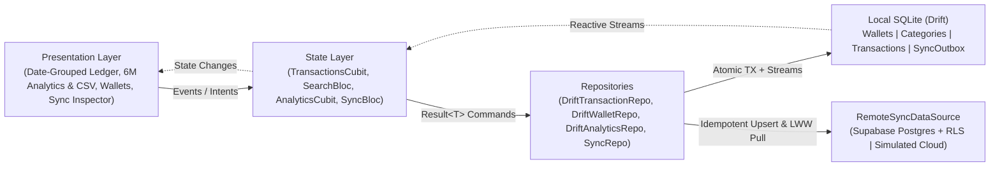
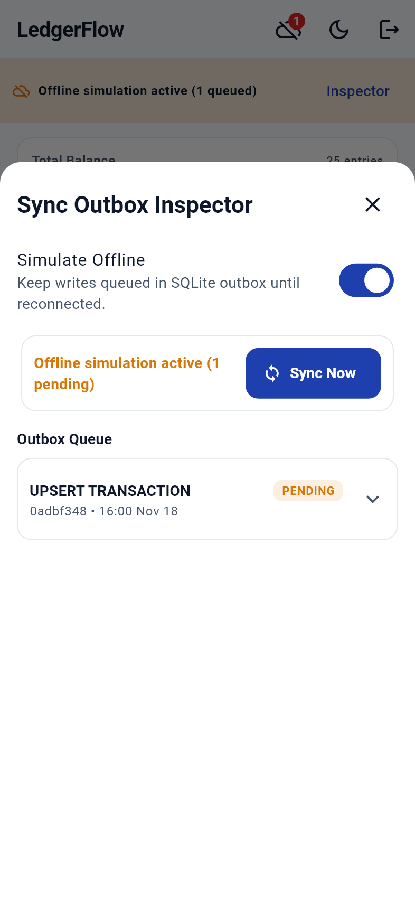
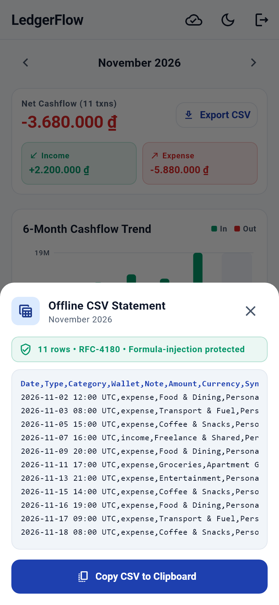

# LedgerFlow — Offline-First Personal & Group Expense Ledger

> An offline-first personal and shared expense tracker built with Flutter, BLoC, Drift (SQLite), transactional outbox synchronization, and Supabase.

[](https://github.com/bachiep/ledgerflow-flutter/actions/workflows/ci.yml)

[](https://github.com/bachiep/ledgerflow-flutter/releases/tag/v2.0.0)


[](LICENSE)

---

## Architecture Overview

LedgerFlow uses **SQLite (`Drift`) as the single source of truth** so every screen updates reactively in under 16ms whether the device is online, in an elevator, or in airplane mode. Every create, edit, soft-delete, or undo restore writes both the domain table (`wallets` / `transactions`) and an immutable mutation entry into `sync_outbox` inside a **single atomic SQLite transaction**, preventing lost writes across app crashes or flaky networks.



### Offline-First Transactional Outbox Sync Sequence


---

## Key Technical Highlights

- **Atomic Transactional Outbox & 5-Second Undo Recovery:** [`AppDatabase.upsertTransactionAtomic`](lib/core/database/app_database.dart), [`softDeleteTransactionAtomic`](lib/core/database/app_database.dart), and [`restoreTransactionAtomic`](lib/core/database/app_database.dart) execute domain mutations and `sync_outbox` appends inside SQLite `transaction(...)` blocks (`PRAGMA foreign_keys = ON`). Deleting from the card menu, swipe gesture, or edit sheet triggers a 5-second `UNDO` SnackBar backed by atomic outbox restoration.
- **Swiss Fintech Theme & Responsive Zero-Overlap Layout:** [`AppTheme`](lib/core/theme/app_theme.dart) pairs Deep Trust Blue (`#1E40AF`), Emerald (`#059669`), and Crimson (`#DC2626`) across crisp `1px`-bordered Light (`#F8FAFC`) and OLED Dark (`#090D16`) surfaces, `FontFeature.tabularFigures()` column alignment, and `96dp` bottom scroll clearance verified across `320px` and `393px` viewports.
- **Date-Grouped Ledger & Tap-to-Edit:** [`LedgerPage`](lib/features/transactions/presentation/pages/ledger_page.dart) groups entries chronologically (`Today`, `Yesterday`, formatted date) with daily net cashflow subtotals, debounced search (`restartable()` 300ms in [`TransactionSearchBloc`](lib/features/transactions/presentation/bloc/transaction_search_bloc.dart)), and prefilled [`TransactionFormSheet`](lib/features/transactions/presentation/widgets/transaction_form_sheet.dart) editing.
- **6-Month SQL Trend, Interactive Budget Editor & Offline CSV Export:**
  - [`AppDatabase.watchMonthlyAnalyticsSql`](lib/core/database/app_database.dart) computes monthly KPIs, category breakdowns, and trailing 6-month `strftime('%Y-%m', ...)` income/expense series rendered via [`CashflowTrendChart`](lib/features/analytics/presentation/widgets/cashflow_trend_chart.dart) (`CustomPainter`) and [`CashflowDonutChart`](lib/features/analytics/presentation/widgets/cashflow_donut_chart.dart).
  - [`BudgetEditorSheet`](lib/features/analytics/presentation/widgets/budget_editor_sheet.dart) persists category budget limits directly to SQLite and refreshes `Near limit` (`>= 80%`) / `Over budget` (`>= 100%`) badges immediately.
  - [`CsvStatementExporter`](lib/features/analytics/domain/csv_statement_exporter.dart) and [`CsvExportSheet`](lib/features/analytics/presentation/widgets/csv_export_sheet.dart) generate RFC-4180 monthly CSV statements with spreadsheet formula-prefix neutralization (`=`, `+`, `-`, `@`), line-by-line monospace preview, and clipboard export.
- **Enriched Wallets & Concurrency-Safe Sync:** [`WalletsPage`](lib/features/wallets/presentation/pages/wallets_page.dart) displays SQL-computed monthly inflow, outflow, net delta, transaction count, and Personal/Shared badges with 1-tap filtered Ledger navigation; [`SyncBloc`](lib/features/sync/presentation/bloc/sync_bloc.dart) uses `droppable()` alongside [`SyncOutboxInspectorSheet`](lib/features/sync/presentation/widgets/sync_outbox_inspector_sheet.dart) and LWW tombstone merging.

---

## Tech Stack

| Layer | Technology | Rationale |
| :--- | :--- | :--- |
| Framework | Flutter `3.41.6` / Dart `3.11.4` | Cross-platform UI, Dart 3 `sealed class` exhaustiveness, Swiss Fintech Light & OLED Dark themes |
| State Management | `flutter_bloc`, `bloc_concurrency`, `equatable` | Explicit state transitions, `Cubit` for UI filters/analytics, `Bloc` (`restartable()`, `droppable()`) |
| Local Persistence | `drift`, `sqlite3`, `sqlite3_flutter_libs` | Type-safe SQLite schema, atomic transactions, SQL aggregations, reactive `Stream` queries |
| Cloud Sync & Auth | `supabase_flutter` | Optional Postgres sync via UUID idempotent `upsert` and RLS (`auth.uid() = user_id`), paired with in-memory `SimulatedRemoteSyncDataSource` |
| Navigation & DI | `go_router`, `get_it` | Auth-guarded `StatefulShellRoute.indexedStack` 3-tab shell and deterministic lifecycle disposal |
| Connectivity & Utils | `connectivity_plus`, `uuid`, `intl` | Network reconnect triggers, client-side UUIDv4 primary keys, locale-aware integer minor-unit formatting |
| Testing | `flutter_test`, `bloc_test`, `mocktail` | In-memory SQLite (`NativeDatabase.memory()`), `FixedClock` determinism, BLoC, CSV & responsive layout tests |

---

## Quick Start

### Prerequisites
- Flutter SDK `>= 3.41.0` & Dart SDK `>= 3.11.0`
- Android SDK / emulator or desktop/web target

### 1. Install Dependencies & Generate Drift Code
```bash
git clone https://github.com/bachiep/ledgerflow-flutter.git
cd ledgerflow-flutter
flutter pub get
dart run build_runner build
```

### 2. Run Instantly in 1-Tap Guest Offline Mode (Zero Backend Setup)
```bash
flutter run
```
On the **Welcome** screen, tap **Continue as Guest (30-Day Sample Data)**. This runs entirely offline using local SQLite + [`SimulatedRemoteSyncDataSource`](lib/features/sync/data/simulated_remote_sync_data_source.dart):
1. Explore date-grouped transactions on **Ledger**, tap any row to edit, or delete and tap **UNDO** within 5 seconds to restore atomically.
2. Open **Analytics** to inspect the 6-Month Cashflow Trend bar chart, tap any category row to adjust its monthly budget cap, or tap **Export CSV** for formula-safe RFC-4180 statement preview and clipboard copy.
3. Open **Wallets** to review monthly inflow, outflow, net delta, and transaction counts per personal or shared wallet, then tap a card to jump directly to its filtered ledger.
4. Tap the cloud status icon in the top bar to open **Sync Outbox Inspector**, toggle **Simulate Offline**, and watch mutations transition `PENDING -> SYNCED`.

### 3. (Optional) Connect Your Own Supabase Project
1. Copy `.env.example` for reference and apply [`supabase/schema.sql`](supabase/schema.sql) in the Supabase SQL Editor (creates `wallets`, `categories`, `transactions` tables + RLS policies + `updated_at` indexes).
2. Run or build with `--dart-define`:
```bash
flutter run \
  --dart-define=SUPABASE_URL=https://your-project.supabase.co \
  --dart-define=SUPABASE_ANON_KEY=your-anon-key
```

### 4. Android Release APK
- Prebuilt signed release APK (`v2.0.0`, `59.6 MB`) is attached on the [GitHub Releases](https://github.com/bachiep/ledgerflow-flutter/releases/tag/v2.0.0) page, or build locally via:
```bash
flutter build apk --release
```

---

## Screenshots

### Mobile UI Preview (`393x852 @2x`)

| Date-Grouped Ledger | 6-Month Trend & Budgets | Sync Outbox Inspector | Wallets (OLED Dark) | Offline CSV Statement |
| :---: | :---: | :---: | :---: | :---: |
|  |  |  |  |  |
| Chronological day sections with net subtotals, tap-to-edit & `SYNCED` pills | 6-month SQL trend chart, donut breakdown & interactive budget alerts | In-app **Simulate Offline** toggle and live `sync_outbox` `PENDING` queue | Personal & Shared badges with monthly inflow, outflow, net delta & tx counts | RFC-4180 CSV preview with formula-injection protection & clipboard copy |

---

## Testing & Verification

Run static analysis and the complete automated test suite (`56` tests across `13` test files — `55` active unit, SQLite, BLoC, and widget tests plus `1` `--dart-define=WRITE_SCREENSHOTS=true` guarded screenshot test):

```bash
flutter analyze --no-pub
flutter test --no-pub --concurrency=1 --timeout 30s
```

> **Windows `Drift` FFI Note:** On Windows, Flutter's `flutter_tester` VM requires a 64-bit `sqlite3.dll` on `PATH` for `NativeDatabase.memory()` unit tests (for example, from Python 3.13 DLLs), and `--concurrency=1` prevents concurrent `flutter_tester.exe` instances from contending over FFI initialization:
> ```powershell
> $env:PATH = "C:\Program Files\Python313\DLLs;$env:PATH"
> flutter test --no-pub --concurrency=1 --timeout 30s
> ```
> On Linux/CI, install `libsqlite3-dev` and run `flutter test --concurrency=1`.

### Verified Test Coverage Summary
- **Core Foundations (`11` tests):** `AppConfig` flag validation (`1`), `Result<T>` / `CurrencyFormatter` minor-unit math, editable input & compact axis formatting / `FixedClock` (`6`), shared `Loading`/`Empty`/`Error` state widgets (`2`), and `ThemeCubit` (`2`).
- **SQLite Outbox, Restore & Seeder (`10` tests):** Atomic `transactions` + `sync_outbox` writes, foreign-key rollback, balance recalculation on edit/soft-delete/`restoreTransactionAtomic`, wallet monthly inflow/outflow/tx-count SQL queries, budget persistence, retry error retention (`attempts` & `last_error`), and idempotent 30-day seeding.
- **Transactions, Date Grouping, Edit & Undo (`13` tests):** `TransactionSearchBloc` `restartable()` 300ms debounce, `TransactionFilterCubit` combinations (`3`), `TransactionsCubit` reactive streams, delete & restore (`5`), `LedgerPage` empty-to-created, date-grouped daily sections, tap-to-edit, 5-second `UNDO` SnackBar recovery, and `320px`/`393px` zero-overflow checks across all 3 tabs (`5`).
- **Analytics, 6M Trend, Budget Editor & CSV Export (`7` tests):** Monthly & 6-month trailing SQL aggregations, UTC month boundaries, `CsvStatementExporter` RFC-4180 quoting & formula-injection escaping (`=`, `+`, `-`, `@`), `AnalyticsEmpty` -> `AnalyticsLoaded` month navigation, `BudgetEditorSheet` live threshold transitions, and `CsvExportSheet` clipboard copy.
- **Sync, Outbox Inspector & Wallets (`13` tests):** `SyncBloc` `droppable()` duplicate prevention, push error retention + retry, LWW delta conflict resolution, 1-tap Guest onboarding (`6`), `SyncInspectorCubit`, `Simulate Offline -> PENDING -> SYNCED` flow, shared group wallet creation, cross-device tombstone propagation, and `320px` keyboard-inset modal layout check (`7`).
- **App Shell Smoke & Screenshot Guard (`2` tests):** `LedgerFlowApp` 3-tab navigation shell + theme toggle (`1`) and `WRITE_SCREENSHOTS` guarded screenshot render test (`1`).

---

## Project Structure

```text
lib/
├── app.dart
├── main.dart
├── core/
│   ├── config/             # AppConfig (--dart-define SUPABASE_URL / SUPABASE_ANON_KEY)
│   ├── database/           # AppDatabase (Drift SQLite), tables, connectors, SampleDataSeeder
│   ├── di/                 # get_it service locator & deterministic disposal
│   ├── error/              # Failure hierarchy
│   ├── models/             # SyncStatus enum
│   ├── result/             # Dart 3 sealed Result<T> (Success / Err)
│   ├── router/             # go_router auth-guarded StatefulShellRoute
│   ├── theme/              # Swiss Fintech Light & OLED Dark ThemeData + ThemeCubit
│   ├── time/               # AppClock & FixedClock abstractions
│   ├── utils/              # Integer minor-unit CurrencyFormatter & compact axis helpers
│   └── widgets/            # Shared LoadingStateWidget, EmptyStateWidget, ErrorStateWidget
└── features/
    ├── analytics/          # 6M SQL trend & donut charts, BudgetEditorSheet, CsvStatementExporter
    ├── auth/               # Guest offline mode & optional Supabase email/password auth
    ├── sync/               # SyncBloc (droppable), SyncOutboxInspectorSheet, LWW sync engine
    ├── transactions/       # Date-grouped Ledger, TransactionsCubit, SearchBloc, FormSheet
    └── wallets/            # Personal & shared group wallets with monthly inflow/outflow/net delta
supabase/
└── schema.sql              # Postgres schema + RLS policies (auth.uid() = user_id)
test/                       # Unit, Drift DB, BLoC/Cubit, CSV, and Widget integration tests (13 files)
```

---

## Tradeoffs & Future Work

- **Conflict Resolution (LWW vs. Field-Level Merge / Event Sourcing):** LedgerFlow uses record-level Last-Write-Wins on `updated_at_epoch_ms` plus soft-delete tombstones (`deleted_at_epoch_ms`), keeping sync logic simple, deterministic, and easy to reason about. For large multi-editor group ledgers, migrating to server-assigned monotonic `row_version` columns or field-level CRDT merges would prevent concurrent offline edits on the same record from overwriting sibling fields.
- **Ledger Pagination & Outbox Batching:** `watchActiveTransactions()` currently streams active filtered rows directly; adding cursor-based pagination (`occurred_at DESC, id DESC` backed by the existing composite index) and chunking outbox pushes into batches of 50 rows will keep memory flat beyond tens of thousands of records.
- **Encrypted Keystore & Biometric Lock:** Adding `sqlcipher_flutter_libs` and `local_auth` is straightforward at the `AppDatabase` connector boundary if device-at-rest SQLite encryption is required.
