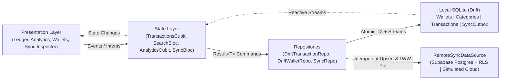
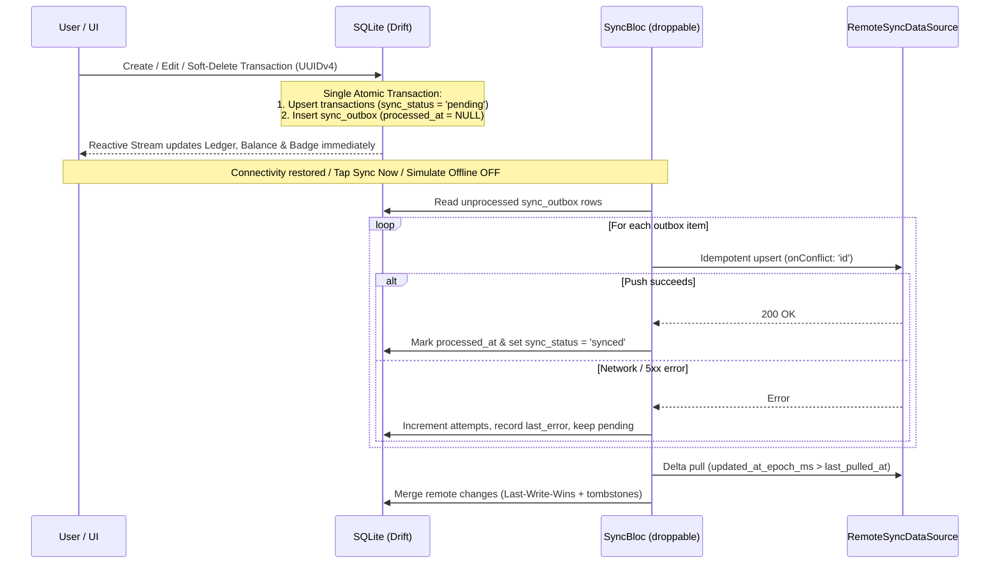
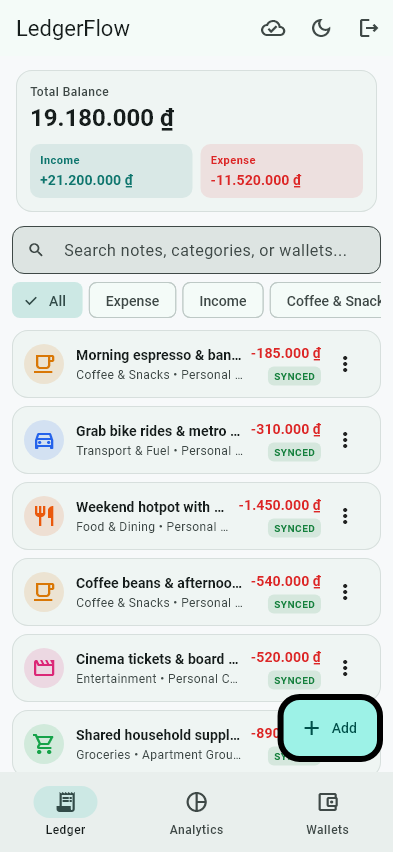
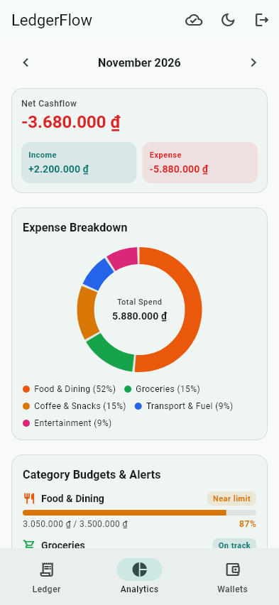
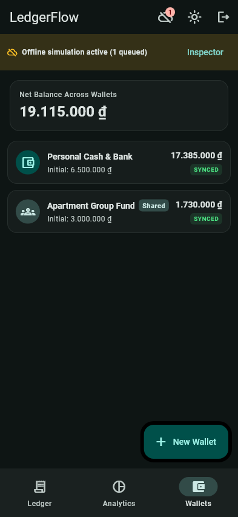

# LedgerFlow — Offline-First Personal & Group Expense Ledger

> An offline-first personal and shared expense tracker built with Flutter, BLoC, Drift (SQLite), transactional outbox synchronization, and Supabase.

[](https://github.com/bachiep/ledgerflow-flutter/actions/workflows/ci.yml)
[](https://github.com/bachiep/ledgerflow-flutter/releases/tag/v1.0.0)


[](LICENSE)

---

## Architecture Overview

LedgerFlow uses **SQLite (`Drift`) as the single source of truth** so every screen updates reactively in under 16ms whether the device is online, in an elevator, or in airplane mode. Every create, edit, or soft-delete writes both the domain table (`wallets` / `transactions`) and an immutable mutation entry into `sync_outbox` inside a **single atomic SQLite transaction**, preventing lost writes across app crashes or flaky networks.



### Offline-First Transactional Outbox Sync Sequence



---

## Key Technical Highlights

- **Atomic Transactional Outbox:** [`AppDatabase.upsertTransactionAtomic`](lib/core/database/app_database.dart), [`upsertWalletAtomic`](lib/core/database/app_database.dart), and [`softDeleteTransactionAtomic`](lib/core/database/app_database.dart) persist business records and outbox payloads together inside SQLite `transaction(...)` blocks with `PRAGMA foreign_keys = ON`.
- **Integer Money Precision & Typed Errors:** All monetary values are stored in integer minor units (`amountMinor`, avoiding `double` rounding bugs) via [`CurrencyFormatter`](lib/core/utils/currency_formatter.dart), and repositories return Dart 3 exhaustive [`Result<T>`](lib/core/result/result.dart) (`Success` / `Err`) wrapping [`Failure`](lib/core/error/failure.dart).
- **Concurrency-Safe BLoC Event Handling:**
  - [`TransactionSearchBloc`](lib/features/transactions/presentation/bloc/transaction_search_bloc.dart) uses `bloc_concurrency`'s `restartable()` transformer with a 300ms debounce so stale search queries are canceled automatically.
  - [`SyncBloc`](lib/features/sync/presentation/bloc/sync_bloc.dart) uses `droppable()` so rapid sync taps or flaky connectivity flickers never run overlapping outbox flushes.
- **SQL-Backed Monthly Cashflow & Budget Dashboard:** [`AppDatabase.watchMonthlyAnalyticsSql`](lib/core/database/app_database.dart) aggregates income, expenses, and per-category spend in SQLite (`SUM`, `GROUP BY`, `JOIN`), rendered with a custom [`CashflowDonutChart`](lib/features/analytics/presentation/widgets/cashflow_donut_chart.dart) (`CustomPainter`) and budget alerts (`Near limit` >= 80%, `Over budget` >= 100%).
- **Live Sync Outbox Inspector & Guest Offline Demo:** [`SyncOutboxInspectorSheet`](lib/features/sync/presentation/widgets/sync_outbox_inspector_sheet.dart) exposes pending/synced/failed outbox payloads, attempt counts, error logs, and a **Simulate Offline** toggle; [`SampleDataSeeder`](lib/core/database/sample_data_seeder.dart) seeds 30 days of realistic Vietnamese personal and shared-fund transactions in a single atomic transaction for instant offline testing.
- **Last-Write-Wins (LWW) Delta Merge & Soft-Delete Tombstones:** [`AppDatabase.applyRemoteChangesLww`](lib/core/database/app_database.dart) compares `updated_at_epoch_ms` deterministically and propagates `deleted_at_epoch_ms` tombstones across devices, backed by Postgres Row-Level Security in [`supabase/schema.sql`](supabase/schema.sql).

---

## Tech Stack

| Layer | Technology | Rationale |
| :--- | :--- | :--- |
| Framework | Flutter `3.41.6` / Dart `3.11.4` | Cross-platform UI, Dart 3 `sealed class` exhaustiveness, Material 3 Light/Dark themes |
| State Management | `flutter_bloc`, `bloc_concurrency`, `equatable` | Explicit state transitions, `Cubit` for UI filters, `Bloc` (`restartable()`, `droppable()`) |
| Local Persistence | `drift`, `sqlite3`, `sqlite3_flutter_libs` | Type-safe SQLite migrations, atomic transactions, SQL aggregations, reactive `Stream` queries |
| Cloud Sync & Auth | `supabase_flutter` | Optional Postgres sync via UUID idempotent `upsert` and RLS (`auth.uid() = user_id`), paired with in-memory `SimulatedRemoteSyncDataSource` fallback |
| Navigation & DI | `go_router`, `get_it` | Auth-guarded `StatefulShellRoute.indexedStack` 3-tab shell and clean dependency injection |
| Connectivity & Utils | `connectivity_plus`, `uuid`, `intl` | Network reconnect triggers, client-side UUIDv4 primary keys, locale-aware currency formatting |
| Testing | `flutter_test`, `bloc_test`, `mocktail` | In-memory SQLite (`NativeDatabase.memory()`), `FixedClock` determinism, BLoC & widget tests |

---

## Quick Start

### Prerequisites
- Flutter SDK `>= 3.41.0` & Dart SDK `>= 3.11.0`
- Android SDK / emulator or desktop/web target

### 1. Install Dependencies & Generate Drift Code
```bash
git clone https://github.com/bachiep/ledgerflow-flutter.git
cd ledgerflow-flutter
flutter pub get
dart run build_runner build
```

### 2. Run Instantly in 1-Tap Guest Offline Mode (Zero Backend Setup)
```bash
flutter run
```
On the **Welcome** screen, tap **Continue as Guest (30-Day Sample Data)**. This runs entirely offline using local SQLite + [`SimulatedRemoteSyncDataSource`](lib/features/sync/data/simulated_remote_sync_data_source.dart):
1. Explore 30 days of pre-seeded personal and apartment group fund entries on **Ledger**, **Analytics**, and **Wallets**.
2. Tap the cloud status icon in the top bar to open **Sync Outbox Inspector** and turn **Simulate Offline** ON.
3. Add or soft-delete a transaction — observe it immediately appear with a **`PENDING`** badge and enqueue inside the outbox inspector.
4. Open **Sync Outbox Inspector** and turn **Simulate Offline** OFF (or tap **Sync Now**) — observe `SyncBloc` flush the outbox and transition items from `PENDING` to `SYNCED`.

### 3. (Optional) Connect Your Own Supabase Project
1. Copy `.env.example` for reference and apply [`supabase/schema.sql`](supabase/schema.sql) in the Supabase SQL Editor (creates `wallets`, `categories`, `transactions` tables + RLS policies + `updated_at` indexes).
2. Run or build with `--dart-define`:
```bash
flutter run \
  --dart-define=SUPABASE_URL=https://your-project.supabase.co \
  --dart-define=SUPABASE_ANON_KEY=your-anon-key
```

### 4. Android Release APK
- Prebuilt signed release APK (`v1.0.0`, `59.3 MB`) is attached on the [GitHub Releases](https://github.com/bachiep/ledgerflow-flutter/releases) page, or build locally via:
```bash
flutter build apk --release
```

---

## Screenshots

### Mobile UI Preview

| Offline Ledger & Search | SQL Cashflow & Budgets | Sync Outbox Inspector | Shared Wallets (Dark Mode) |
| :---: | :---: | :---: | :---: |
|  |  |  |  |
| 30-day seeded ledger with instant `Drift` SQLite stream updates and `SYNCED` status pills | SQL `SUM`/`GROUP BY` donut breakdown and threshold budget alerts (`Near limit 87%`) | In-app **Simulate Offline** toggle and live `sync_outbox` queue showing `PENDING` mutations | Personal & Shared group wallets with Material 3 dark theme |

---

## Testing & Verification

Run static analysis and the complete automated test suite (`42` unit, integration, BLoC, and widget tests across `12` test files):

```bash
flutter analyze --no-pub
flutter test --no-pub --concurrency=1 --timeout 30s
```

> **Windows `Drift` FFI Note:** On Windows, Flutter's `flutter_tester` VM requires a 64-bit `sqlite3.dll` on `PATH` for `NativeDatabase.memory()` unit tests (for example, from Python 3.13 DLLs), and `--concurrency=1` prevents concurrent `flutter_tester.exe` instances from contending over FFI initialization:
> ```powershell
> $env:PATH = "C:\Program Files\Python313\DLLs;$env:PATH"
> flutter test --no-pub --concurrency=1 --timeout 30s
> ```
> On Linux/CI, install `libsqlite3-dev` and run `flutter test --concurrency=1`.

### Verified Test Coverage Summary
- **Core Foundations (`9` tests):** `AppConfig` flag validation (`1`), `Result<T>` / `CurrencyFormatter` integer minor-unit math / `FixedClock` (`4`), shared `Loading`/`Empty`/`Error` state widgets (`2`), and `ThemeCubit` (`2`).
- **SQLite Outbox & Seeder (`7` tests):** Atomic `transactions` + `sync_outbox` persistence, foreign-key rollback, balance recalculation on edit/soft-delete, retry error retention (`attempts` & `last_error`), and idempotent 30-day seeding.
- **Transactions, Search & Filter (`8` tests):** `TransactionSearchBloc` `restartable()` 300ms debounce, `TransactionFilterCubit` combinations (`3`), `TransactionsCubit` reactive stream updates (`4`), and `LedgerPage` empty-to-created widget flow (`1`).
- **Analytics & Budget Alerts (`4` tests):** Monthly SQL `SUM`/`GROUP BY`/`JOIN` aggregation, UTC month boundaries, `AnalyticsEmpty` -> `AnalyticsLoaded` month navigation, and `>= 80%` / `>= 100%` budget badges.
- **Sync, Outbox Inspector & Wallets (`13` tests):** `SyncBloc` `droppable()` duplicate prevention, push error retention + retry, LWW delta conflict resolution, 1-tap Guest onboarding (`6`), `SyncInspectorCubit`, `Simulate Offline -> PENDING -> SYNCED` flow, shared group wallet creation, cross-device soft-delete tombstone propagation, and `320px` keyboard-inset overflow check (`7`).
- **App Shell Smoke (`1` test):** `LedgerFlowApp` 3-tab navigation shell and theme toggle (`42/42` total passed).

---

## Project Structure

```text
lib/
├── app.dart
├── main.dart
├── core/
│   ├── config/             # AppConfig (--dart-define SUPABASE_URL / SUPABASE_ANON_KEY)
│   ├── database/           # AppDatabase (Drift SQLite), tables, connectors, SampleDataSeeder
│   ├── di/                 # get_it service locator & deterministic disposal
│   ├── error/              # Failure hierarchy
│   ├── models/             # SyncStatus enum
│   ├── result/             # Dart 3 sealed Result<T> (Success / Err)
│   ├── router/             # go_router auth-guarded StatefulShellRoute
│   ├── theme/              # Material 3 Light/Dark themes & ThemeCubit
│   ├── time/               # AppClock & FixedClock abstractions
│   ├── utils/              # Integer minor-unit CurrencyFormatter
│   └── widgets/            # Shared LoadingStateWidget, EmptyStateWidget, ErrorStateWidget
└── features/
    ├── analytics/          # SQL cashflow summary, CustomPainter donut chart, budget alerts
    ├── auth/               # Guest offline mode & optional Supabase email/password auth
    ├── sync/               # SyncBloc (droppable), SyncOutboxInspectorSheet, LWW sync engine
    ├── transactions/       # TransactionsCubit, SearchBloc (restartable), FilterCubit, FormSheet
    └── wallets/            # Personal & shared group wallets CRUD + net balance queries
supabase/
└── schema.sql              # Postgres schema + RLS policies (auth.uid() = user_id)
test/                       # Unit, Drift DB, BLoC/Cubit, and Widget integration tests (12 files)
```

---

## Tradeoffs & Future Work

- **Conflict Resolution (LWW vs. Field-Level Merge / Event Sourcing):** LedgerFlow uses record-level Last-Write-Wins on `updated_at_epoch_ms` plus soft-delete tombstones (`deleted_at_epoch_ms`), keeping sync logic simple, deterministic, and easy to reason about. For large multi-editor group ledgers, migrating to server-assigned monotonic `row_version` columns or field-level CRDT merges would prevent concurrent offline edits on the same record from overwriting sibling fields.
- **Ledger Pagination & Outbox Batching:** `watchActiveTransactions()` currently streams active filtered rows directly; adding cursor-based pagination (`occurred_at DESC, id DESC` backed by the existing composite index) and chunking outbox pushes into batches of 50 rows will keep memory flat beyond tens of thousands of records.
- **Encrypted Keystore & Biometric Lock:** Adding `sqlcipher_flutter_libs` and `local_auth` is straightforward at the `AppDatabase` connector boundary if device-at-rest SQLite encryption is required.
